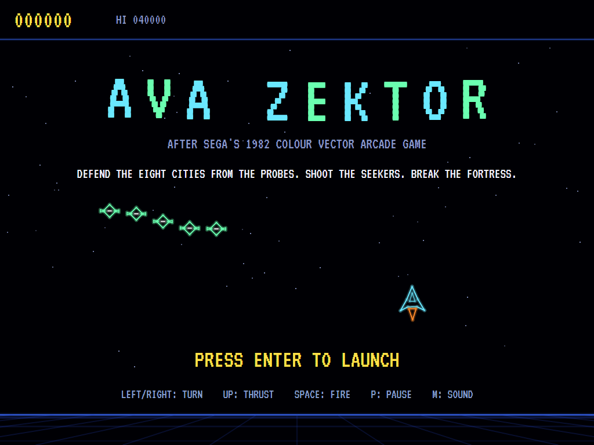
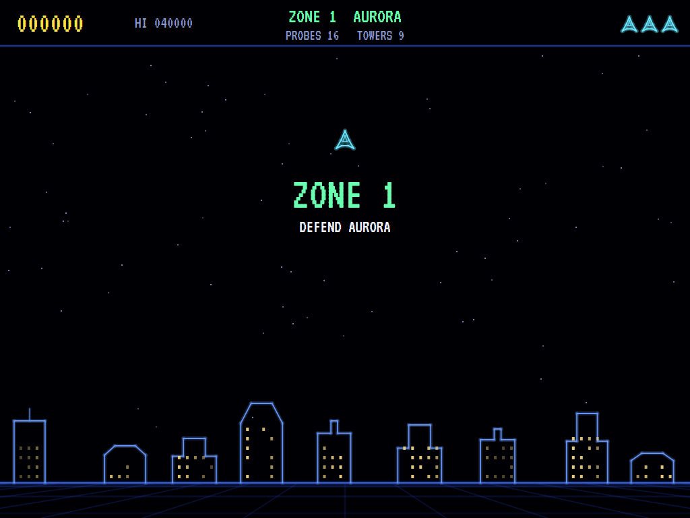
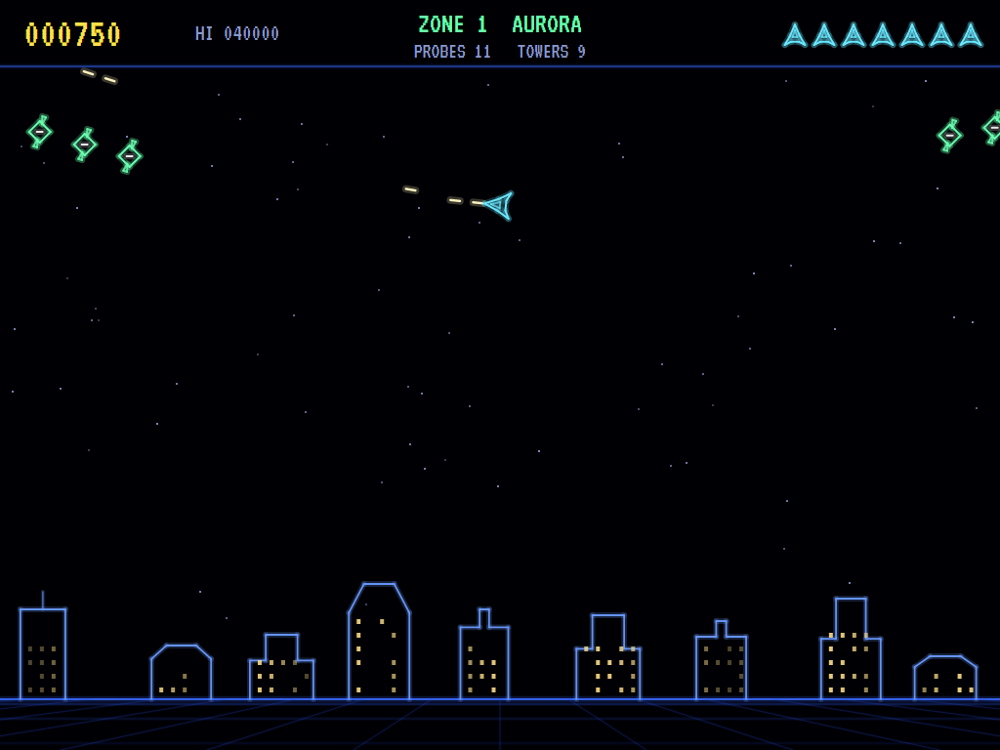
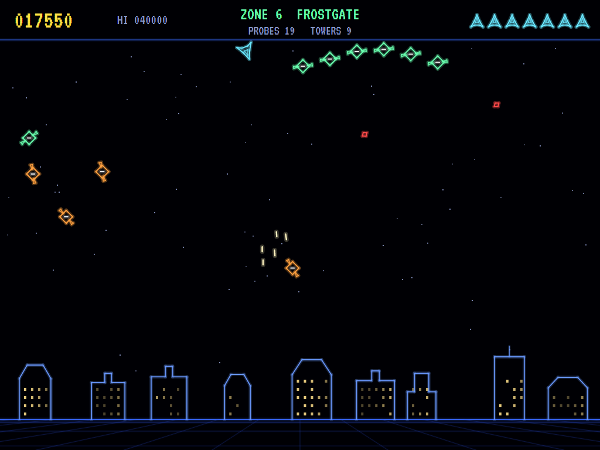
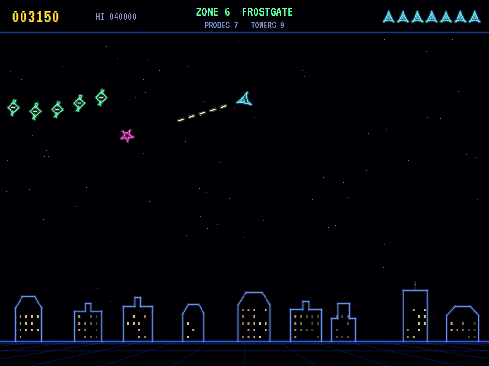
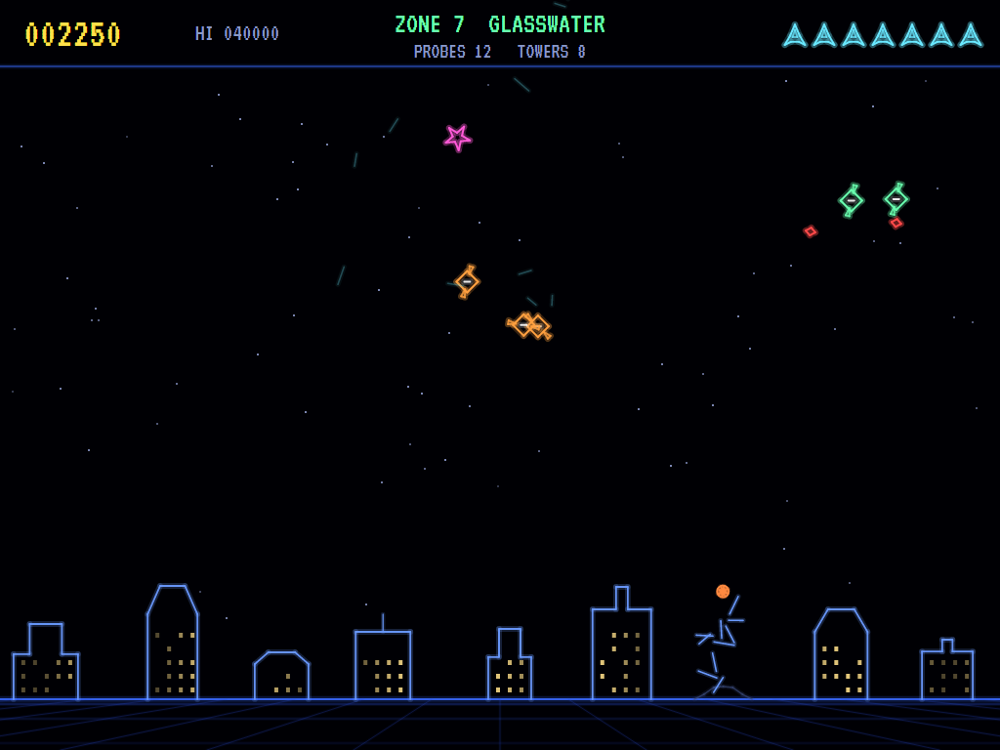
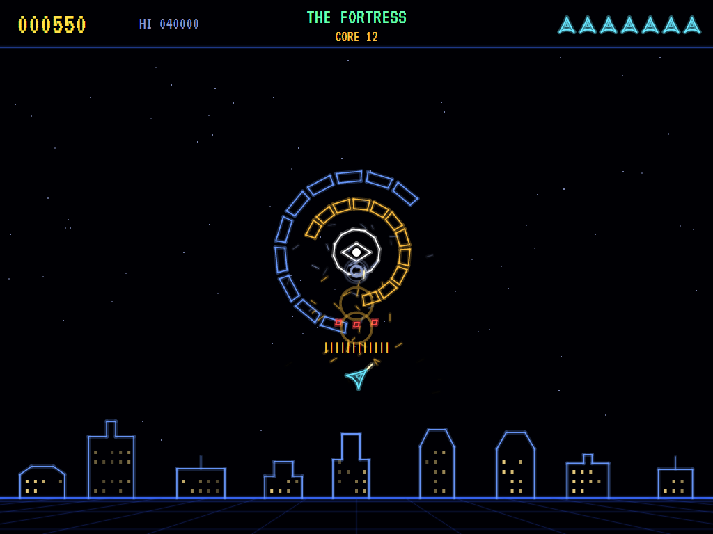
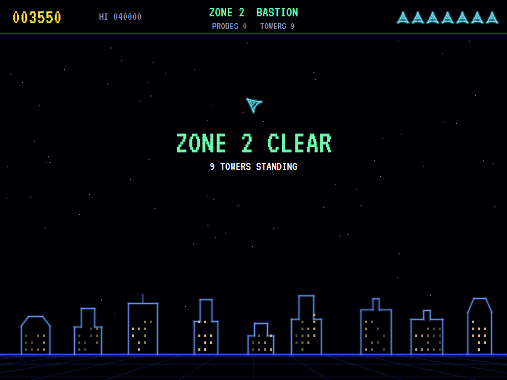
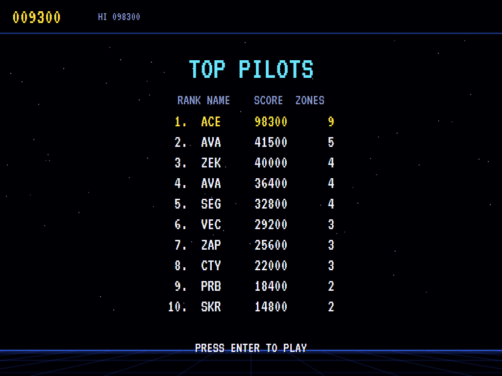

# AVA Zektor

[](https://github.com/Harlock123/AVAZektor/actions/workflows/build.yml)

A colour vector shooter in the style of Sega's 1982 arcade game **Zektor**, built with .NET 10 and Avalonia
UI. Fly a thrust-and-turn fighter over eight cities, each under its own patch of sky. Formations of probes
sweep across and break off to dive on the towers below, and on you. Seekers hunt you down. Clear all eight
zones and you face the fortress: two counter-rotating rings of armour around a core that opens its eye only
now and then. Mission control calls it all out in a synthesised voice.

## Features

- **The ship** turns, thrusts and coasts, and wraps round the sides of the sky (not through the ground). It
  can keep five shots in the air.
- **Eight zones:** Aurora, Bastion, Cinderfall, Duskhaven, Emberly, Frostgate, Glasswater and Highspire.
  Each has its own skyline of vector towers with lit windows. The towers left standing when the zone is
  cleared are counted into the score.
- **Probes** come in formations of five to seven, weaving across the sky as they settle. Sooner or later
  each breaks off to dive, on a tower (which it brings down) or on you. They fire as they go, and a diving
  probe is worth double.
- **Seekers** start hunting partway through each zone: homing mines that turn after you wherever you go,
  until they burn out.
- **The fortress** comes after the eighth zone. Shoot away pieces of its two rings of armour (two hits each,
  and they grow back) for a shot at the core, which can only be hurt while its eye is open. Break it, and the
  cities come round again, faster.
- **Mission control speaks:** "Zone one" to "Zone eight", "Warning, seekers!", "City under attack!", "Zone
  clear", "Fortress ahead!", "Fortress destroyed!", and "Defend the cities!" on the title screen. The voice is
  synthesised from scratch the way the talking arcade machines of the day did it: a buzz and a hiss shaped
  by formant filters (`tools/speech.py`), with the words written out as phonemes. No recording or speech
  engine is involved.
- **An extra ship** at 10,000 points and every 30,000 after.
- **The attract mode** shows the computer pilot at work. It thrusts out of the way of anything about to hit
  it, leads its targets, and makes a seeker close by or a probe diving on the city its first concern.

## Screenshots

| The title | Zone one | A formation |
|:---------:|:--------:|:-----------:|
|  |  |  |
| Defend the cities. | Aurora, before the probes. | Weaving across the sky. |

| A dive | Seekers | A tower falls |
|:------:|:-------:|:-------------:|
|  |  |  |
| Probes breaking off. | Hunted. | Glasswater, hit. |

| The fortress | Zone clear | Top pilots |
|:------------:|:----------:|:----------:|
|  |  |  |
| Through the rings, the eye open. | The towers counted. | The high-score table. |

The screenshots are made by the tests, which play the game in a real (headless) window; see
[Tests](#tests).

## Download and run

Ready-to-run builds for Windows, macOS and Linux, on both Intel/AMD and ARM, are on the
[Releases page](https://github.com/Harlock123/AVAZektor/releases/tag/latest). **Latest build** is
rebuilt on every push to `main`. Each download is one self-contained executable: no .NET install is
needed.

| Platform | Archive |
|---|---|
| Windows | `AVAZektor-win-x64.zip`, `AVAZektor-win-x86.zip`, `AVAZektor-win-arm64.zip` |
| macOS | `AVAZektor-osx-arm64.tar.gz` (Apple silicon), `AVAZektor-osx-x64.tar.gz` (Intel) |
| Linux | `AVAZektor-linux-x64.tar.gz`, `AVAZektor-linux-arm64.tar.gz`, `AVAZektor-linux-arm.tar.gz` |

```bash
tar -xzf AVAZektor-linux-x64.tar.gz     # or linux-arm64, linux-arm, osx-arm64, osx-x64
./AVAZektor
```

On Windows, unzip and run `AVAZektor.exe`. On macOS, if Gatekeeper refuses to open it, run
`xattr -d com.apple.quarantine AVAZektor` once. Run with `--no-audio` for silence.

**Sound** comes through OpenAL Soft, built in for every platform. In a virtual machine the game
detects it and uses a larger audio buffer, so the sound doesn't break up.

**Gamepads** use SDL2, which is bundled for Windows, macOS and Intel/AMD Linux. ARM Linux builds need it
installed; without it the keyboard still works:

```bash
sudo apt install libsdl2-dev            # Debian / Ubuntu / Raspberry Pi OS
sudo pacman -S --needed sdl2-compat     # Arch / Omarchy
```

## Controls

| Action | Keyboard | Gamepad |
|---|---|---|
| Start | Enter or 1 | Start |
| Turn | Left/right arrows or A/D | Left stick / D-pad |
| Thrust | Up arrow or W | Up |
| Fire | Space, Ctrl, Shift, Z or X | A or B |
| Pause | P or Esc | Start or Back |
| Sound on/off | M | |
| Screenshot | Ctrl+S (to your Pictures folder) | |

On the high-score table, type your initials, or use up/down and Space, then Enter.

## Tests

```bash
dotnet test AVAZektor.slnx
```

The engine has no UI and runs in fixed 60 Hz steps, so it plays the same at any frame rate. The tests check:

- **The ship:** turning, thrusting, wrapping round the sides but stopping at the ground; five shots at most.
- **Probes:** a shot destroys one, and a diving one is worth more. Formations come until the quota is
  reached, and the zone clears, its towers counted, when every probe has been dealt with. A diving probe
  brings down the tower it hits. Running into a probe, or its shot, loses the ship.
- **Seekers:** one hunts the ship and burns out in the end; they start coming partway through a zone, with a
  spoken warning.
- **The fortress:** it comes after the eighth zone, with the ship starting well clear. Its armour takes two
  hits a piece, and the core is only hurt with its eye open. Breaking it starts the next round, faster.
- **The game:** the last ship lost and the high-score table; a lost ship coming back safe for a moment; the
  extra ship at 10,000; mission control's voice on the title and at each zone; the demonstration and the
  high scores; the keys. The computer pilot breaks the fortress in round one.

`tests/AVAZektor.Tests/PilotProbe.cs` reports how the computer pilot gets on over whole games, for tuning
(`ZEKTOR_PROBE=1`; `ZEKTOR_PROBE=lazy` for a pilot that only turns and fires).

The screenshot tests draw the real screen in a headless window. To refresh the README's pictures:

```bash
ZEKTOR_SHOTS=$PWD/Images dotnet test tests/AVAZektor.Tests --filter ScreenshotTests
```

## Building

```bash
dotnet build AVAZektor.slnx
dotnet run --project src/AVAZektor
```

Needs the .NET 10 SDK. The sounds, tunes and mission control's voice are made by `tools/make_sounds.py`
(standard-library Python): `python3 tools/make_sounds.py` rewrites `src/AVAZektor/Sounds`.

## Project structure

```
AVAZektor/
├── AVAZektor.slnx
├── src/AVAZektor/
│   ├── Engine/
│   │   ├── GameEngine.cs        # States, the title, the demonstration, the high scores
│   │   ├── GameEngine.Play.cs   # The ship, zones and their cities, probes, seekers, the fortress, hits
│   │   ├── Entities.cs          # The sky, the ship, shots, probes, seekers, towers, the fortress
│   │   ├── Pilot.cs             # The computer pilot (the demonstration, and the tests)
│   │   ├── HighScoreTable.cs, InitialsEntry.cs
│   │   ├── InputHandler.cs, ControllerManager.cs  # Keys and an SDL2 gamepad
│   │   └── SoundManager.cs      # Effects, the voice and the tunes through OpenAL
│   ├── Audio/                   # The OpenAL engine (from the author's AVABand)
│   ├── Views/                   # The drawing: glowing vector lines, the cities, the fortress
│   └── Sounds/                  # The synthesised effects, tunes and voice
├── tests/AVAZektor.Tests/       # Gameplay and screenshot tests
├── tools/make_sounds.py, tools/speech.py
└── Images/                      # Screenshots
```

## About and licence

AVA Zektor © 2026 Lonnie Watson, under the [MIT License](LICENSE).

*Zektor* © 1982 Sega; the name belongs to its current owner. AVA Zektor is an independent, unofficial game
in its style. Its zones and cities, its probes, seekers and fortress, its graphics, sounds, tunes, voice and
code are its own; nothing is taken from the original game's program, graphics, sound or speech. It is not
affiliated with or endorsed by any rights holder.
